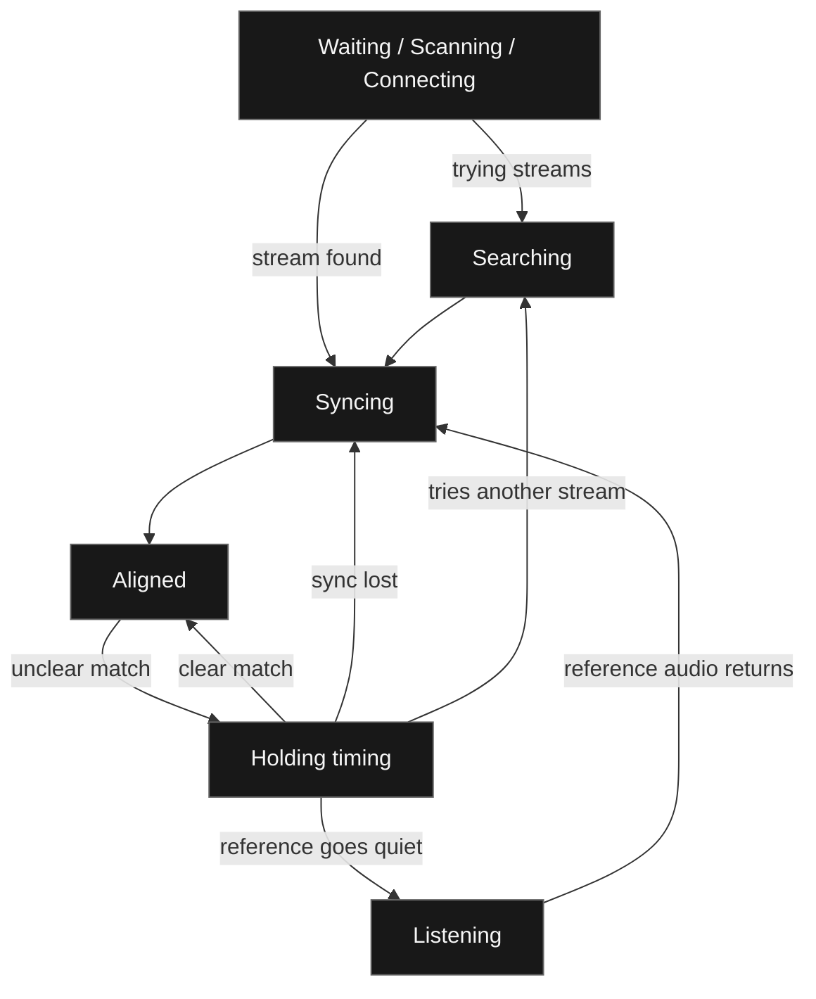

When you stream a VRChat world through OBS, the world's video player is usually behind a direct copy of the same stream. If you send that direct audio straight to OBS, viewers can hear the next beat before the world plays it. VaOBS holds the faster audio back so it lines up with what’s happening in VRChat.

VaOBS reads the stream URL from the VRChat log and takes the audio it sends to OBS directly from its own copy of the stream. It works out when to play it by comparing that feed with what the VRChat audio source in OBS is picking up. People can talk over the music or video as long as enough of the original sound comes through for VaOBS to recognize it.

## What you’ll see in OBS

### Waiting for a stream

**Waiting** means VaOBS is waiting for a VRChat client or a stream URL. **Scanning** means it’s checking URLs from the log. **Connecting** means it’s waiting for a stream to send audio. If the stream is **Unavailable**, VaOBS can retry. If the URL has expired, reload the player in VRChat. **Paused** means the selected stream is paused.

### Listening

**Listening** means VaOBS needs audible sound from the VRChat audio source in OBS. A silent passage or voices drowning out the stream can make it harder to find a match.

### Searching and syncing

**Searching** means VaOBS is trying streams from the log. **Syncing** means it’s working out how far behind VRChat is. It keeps a short history of both feeds on the same timeline and slides one against the other to see where they line up best. That’s cross-correlation. A repeating beat can fit in several places, so VaOBS checks that the timing agrees across more than one passage before using it.

### Aligned

**Aligned** shows how much delay VaOBS is adding to the direct feed. That gives viewers the direct audio at the moment it belongs in the world. VaOBS follows small changes in timing as the two players run.

### Holding timing

If the match gets unclear for a while, VaOBS can keep using the last reliable delay. You may see **Aligned** with a note that it’s holding timing, or **Listening** if reference audio drops out. A big jump needs a fresh match. If VaOBS loses sync, it mutes its own output while it looks for a match again.

[Alignment code](https://github.com/Hackebein/VaOBS/blob/v1.4.0/src/alignment.hpp) · [OBS integration](https://github.com/Hackebein/VaOBS/blob/v1.4.0/src/plugin.cpp)
