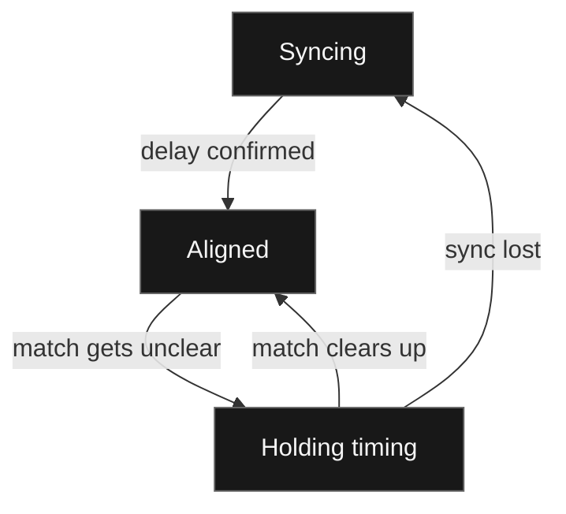

When you capture VRChat in OBS, voices, menu sounds, world audio, and the video player all come through in one mix. VaOBS adds a second audio source with just the video player’s sound. That gives you a clean source you can record separately, timed to the picture from VRChat.

VaOBS gets the stream URL from the VRChat log and takes its clean audio directly from its own copy of that stream. The player in VRChat runs behind that copy. Play the clean feed straight away and you might hear a drum hit before you see it in the world. VaOBS buffers the clean feed to match the slower player.

## How the sync works

### Finding the delay

VaOBS measures the delay by comparing the clean feed with what OBS actually hears from VRChat. It keeps a short history of both on the same clock, then looks for where a recent passage from the VRChat mix lines up best with the clean feed. That comparison is called cross-correlation. People can talk over the music as long as enough of it is still audible to match.

### Aligned

Once VaOBS has a consistent match, it adds the measured delay to its own audio. The original VRChat mix is still available in OBS, and the clean source now follows the picture. VaOBS keeps comparing the two signals so it can follow small changes in the delay as the players run.

### Holding timing

If the music goes quiet or gets drowned out, VaOBS can keep using the last delay it could measure. If the timing jumps, it checks the new delay before switching to it. If it loses sync, the clean source goes silent while VaOBS looks for a match again.

[Alignment code](https://github.com/Hackebein/VaOBS/blob/v1.4.0/src/alignment.hpp) · [OBS integration](https://github.com/Hackebein/VaOBS/blob/v1.4.0/src/plugin.cpp)
